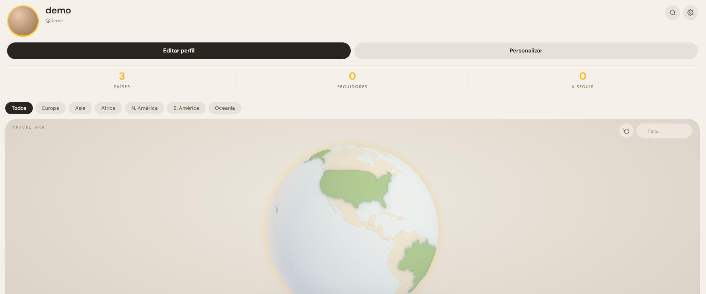
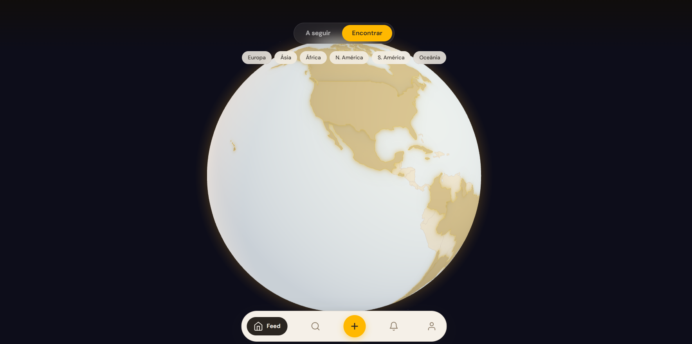

<div align="center">

# 🌍 Volta

**A travel social network built around a 3D globe.**
Spin the globe, pick a country and read the stories of people who have been there.

[](https://nextjs.org)
[](https://react.dev)
[](https://www.typescriptlang.org)
[](https://supabase.com)
[](https://blog-app-j68i.vercel.app)

**[▶ Open the live demo](https://blog-app-j68i.vercel.app)**

</div>



## About

Travel blogs are usually organised by date or by author. In **Volta** they are organised **by the map**: each user marks the countries they have visited on the globe and writes about them, and anyone exploring the app spins the globe and clicks a country to read the blogs about that destination.

It is a personal project, built solo, to learn how to ship a complete web application: from a 3D frontend to the database, authentication and deployment.

> **Status:** in development. The core features work; the missing ones are listed under [Roadmap](#roadmap). The app interface is in Portuguese.

## Try it

Open the **[live demo](https://blog-app-j68i.vercel.app)** and sign in with the demo account, no registration needed:

| Email | Password |
|---|---|
| `demo@volta.app` | `Demo2000` |

In the **feed**, under the **Encontrar** (Discover) tab, there are blogs from other users to explore: spin the globe, click a glowing country and open the posts.

> The blogs published in the demo are **test content**, created to showcase the app's features.

## Features

**3D globe**
- Interactive globe (spin, zoom, click a country) with visited countries highlighted
- Continent filters that rotate the globe to each continent, plus country search
- Each user customises the colour of their own globe
- In the feed, countries with unread blogs glow

**Travel blogs**
- Block-based editor: rich text, image, image with text, YouTube video, Spotify music and dividers
- Drag-and-drop block reordering, plus colour and font themes per post
- Drafts, publishing and editing; blogs grouped by country

**Social**
- Follow users, private profiles and follower lists
- Feed with two tabs: **Following** and **Discover** (blogs from the whole community)
- In **Following**, a stories bar shows the people you follow; selecting one switches the feed globe to **their personalised globe**, with only their countries and blogs
- Likes, comments and notifications
- Viewed-post tracking, so unread posts are shown first

**Account**
- Sign-up, login and onboarding for new users
- Profile editing, email and password changes, and privacy settings



## Tech stack

| Layer | Technologies |
|---|---|
| Frontend | Next.js 16 (App Router), React 19, TypeScript, Tailwind CSS 4 |
| 3D globe | Three.js, react-globe.gl, TopoJSON |
| Editor | TipTap (rich text), dnd-kit (drag and drop) |
| Backend | Supabase: PostgreSQL, authentication and file storage |
| Deployment | Vercel |

## How it works

The app has no custom backend server: the Next.js frontend talks directly to **Supabase**, which handles the PostgreSQL database, authentication and image storage.

```
Browser (Next.js + React)
   │  supabase-js (public anon key)
   ▼
Supabase ── PostgreSQL (data + RLS policies)
         ├─ Auth (accounts and sessions)
         └─ Storage (post and profile images)
```

**Data model**

| Table | Stores |
|---|---|
| `profiles` | Users: name, photo, bio, globe colour, privacy |
| `posts` | Blogs: country, title, content blocks, theme, publication status |
| `countries_visited` | Countries marked by each user |
| `follows` | Who follows whom |
| `likes`, `comments` | Post interactions |
| `notifications` | New follower, like and comment notifications |
| `post_views` | Posts already viewed by each user |

## Technical decisions

- **Video and music via embeds, with no file storage.** Storing videos in Supabase would exceed the free plan. Video and music blocks only store the YouTube or Spotify link and render the embedded player, so storage cost is zero.
- **Sanitising post content.** Rich text is stored as HTML and rendered with `dangerouslySetInnerHTML`. To prevent XSS attacks, all HTML goes through **DOMPurify** with a strict allowlist of tags and attributes, and links only accept `http(s)`, `mailto` and relative paths.
- **Database-level security.** Since the browser accesses Supabase with the public key, permissions are enforced by **Row Level Security (RLS) policies** in PostgreSQL: each user can only modify their own data, and private profiles are enforced in the database too: their posts (and the likes and comments on them) are only readable by the author and their followers.
- **Notifications created only by the database.** Like, comment and follow notifications are generated by PostgreSQL triggers (`SECURITY DEFINER` functions), and there is no insert policy for clients, so nobody can create fake notifications through the public API.

## Running locally

Requirements: Node.js 20+ and a [Supabase](https://supabase.com) project (the free plan is enough).

```bash
git clone https://github.com/gusta24012006/BlogApp.git
cd BlogApp/wanderlog
npm install
cp .env.example .env.local   # fill in your Supabase project URL and anon key
npm run dev
```

Before the first run, set up the database in your Supabase project:

1. In the **SQL Editor**, run [`supabase/schema.sql`](supabase/schema.sql): it creates the tables, indexes, RLS policies, functions and triggers.
2. In **Storage**, create a public bucket named `post-media` (post and profile images).

The app runs at [http://localhost:3000](http://localhost:3000).

## Known limitations

- **Following a private profile does not need approval yet.** Private profiles are hidden from Discover and their posts are protected by RLS, but anyone can follow them and then see their posts. Proper follow requests are on the roadmap.
- **New sign-ups may fail** in the demo, because Supabase's default email service only sends a few emails per hour. Use the demo account above instead.

## Project structure

```
wanderlog/                 Next.js app
├─ src/app/                pages: feed, dashboard, blog, profile, search, settings…
├─ src/components/         Globe, block editor, navbar, post actions
└─ src/lib/                Supabase clients and HTML sanitisation
supabase/schema.sql        database schema, RLS policies and triggers
design/prototipo/          early prototype of the profile screen
docs/                      README images
```

## Roadmap

- [x] Deploy the demo to Vercel
- [x] Export the database schema and RLS policies to the repository
- [x] Enforce private profiles in the RLS read policies
- [ ] Follow requests for private profiles
- [ ] In Discover mode, hide blogs already viewed and stop a country glowing once it has nothing left to read
- [ ] "Surprise me" button: the globe spins and zooms into a random country with an unread blog
- [ ] Set up a custom email service for account confirmation
- [ ] Split the `Globe.tsx` component into smaller components
- [ ] Automated tests

## Author

**Gustavo Monteiro**, Informatics and Computing Engineering student at FEUP (University of Porto)

[LinkedIn](https://www.linkedin.com/in/gustavomonteiro06) · [GitHub](https://github.com/gusta24012006) · gustavotibe@gmail.com
